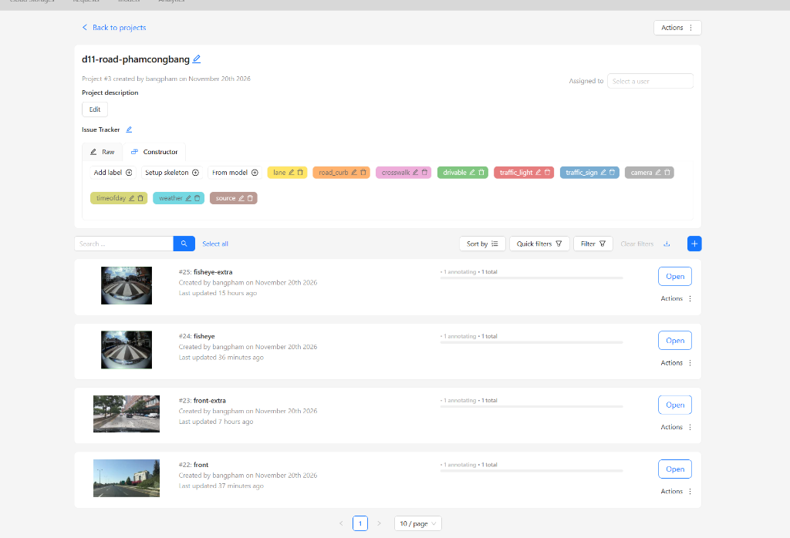
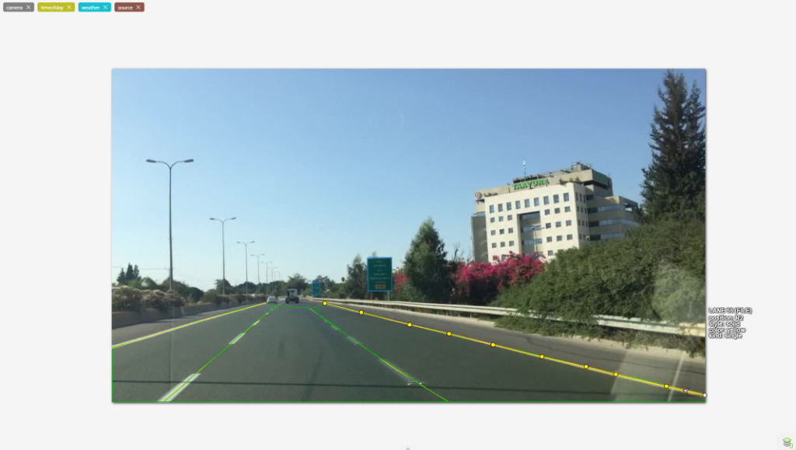
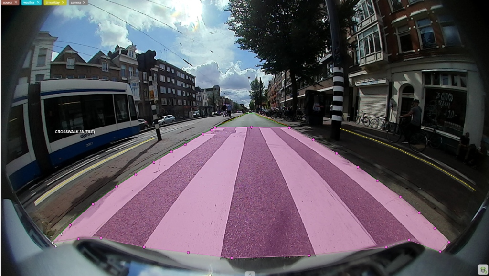

# Báo cáo cá nhân — Ngày 11
Họ tên: Phạm Công Bằng
Mã học viên: 2A202603134
Phiên bản CVAT: 2.14.0
Guideline: Road v1.0
Lần nộp: 1
Thời điểm export: 21/11/2026
Số lần nộp lại sau Rework: 0

## 1. Kiểm project
| Mục | Đúng như guideline Road v1.0? | Ghi chú |
| --- | --- | --- |
| 6 label, đúng kiểu | Đúng | Đủ 6 label theo quy định |
| Thuộc tính và giá trị | Đúng | Đủ các thuộc tính của từng nhãn |
| 4 tag ảnh | Đúng | Đủ 4 tag bắt buộc |

Cách kết thúc polyline trên bản CVAT này: Nhấp đúp chuột trái hoặc bấm phím Space.  
Cách đặt tag ảnh trên bản CVAT này: Chọn mục Tags ở cột bên phải rồi chọn giá trị tương ứng.  

## 2. Số lượng đã gán
| Task | Ảnh | lane | road_curb | crosswalk | drivable | traffic_light | traffic_sign |
| --- | ---: | ---: | ---: | ---: | ---: | ---: | ---: |
| front | 12 | 30 | 8 | 4 | 23 | 30 | 37 |
| front-extra | 0 | 0 | 0 | 0 | 0 | 0 | 0 |
| fisheye | 8 | 9 | 7 | 6 | 4 | 6 | 1 |
| fisheye-extra | 0 | 0 | 0 | 0 | 0 | 0 | 0 |

## 3. Bảng ca khó
| Ảnh | Nhãn | Phân vân giữa | Đã chọn | Lý do |
| --- | --- | --- | --- | --- |
| A04 | lane | Vẽ 2 vạch đơn hay 1 vạch đôi | 1 vạch double | Tim đường có vạch đôi nên vẽ một polyline và chọn loại double |
| A05 | road_curb | Gán vạch lane hay lề đường curb | road_curb | Mép đường là vỉa hè không có sơn kẻ nên gán curb |
| B05 | lane | Chọn vị trí làn bình thường hay other | other | Ảnh chụp từ camera sườn xe nên theo quy tắc phải gán other |
| B01 | drivable | Có khoét bỏ phần xe ô tô phía trước không | Không khoét bỏ xe | Quy định vùng lái xe là toàn bộ mặt đường đi được kể cả có xe chắn |

## 4. Phiếu QC 1 nhận được
Bạn kiểm lô của tôi: Trần Quang Vinh  
Quyết định nhận được: Release  
| Mã lỗi | Số lỗi | Đồng ý? | Đã sửa? |
| --- | ---: | --- | --- |
| QC1-06 | 1 | Đồng ý | Đã sửa vạch biên ở A10 thành solid |
| QC1-09 | 2 | Đồng ý | Đã chỉnh lại hướng facing cho đèn và biển ở A03, A08 |
| QC1-11 | 1 | Đồng ý | Đã nắn lại điểm polyline cho khớp cung cong ở B03 |

## 5. Kiểm file export
| File | Mở lại được? | Số shape ảnh 1 | Số shape ảnh 2 | Tag camera có trong XML? |
| --- | --- | --- | --- | --- |
| phamcongbang-front.zip | Có | 9 | 6 | Có |
| phamcongbang-fisheye.zip | Có | 6 | 6 | Có |

## 6. Ảnh chụp màn hình
1. Tab Labels của project:  


2. Ảnh camera trước đã gán:  


3. Ảnh fisheye đã gán:  


4. Đoạn XML nhãn lane:  
```xml
<polyline label="lane" source="manual" occluded="0" points="726.05,719.00;689.07,696.90;652.99,674.08;604.09,643.83;579.54,626.30;540.28,599.21;496.32,567.78;461.76,542.92;426.63,517.48" z_order="0">
  <attribute name="position">R1</attribute>
  <attribute name="style">dashed</attribute>
  <attribute name="color">white</attribute>
  <attribute name="kind">single</attribute>
</polyline>
```

## 7. Tự đánh giá
Lỗi bạn mắc nhiều nhất hôm nay, và cách tránh ở Ngày 20:  
Lúc mới làm tôi hay bị quen tay vẽ vạch từ xa về gần thay vì từ gần ra xa, và đôi khi quên đổi thuộc tính position sang other ở mấy ảnh camera bên hông xe. Sang ngày 20 tôi sẽ tạo thói quen kiểm tra góc camera trước, sau đó luôn bắt đầu chấm điểm polyline từ sát mép dưới màn hình đi lên.

Nhãn của bạn đi vào model ở đâu? Chọn một lỗi đã sửa và nói nó làm model học sai thế nào:  
Các polyline vạch đường được đưa vào huấn luyện mô hình phát hiện làn xe để hỗ trợ giữ làn tự động. Nếu vạch đứt bị vẽ ngắt quãng thành nhiều đoạn ngắn riêng rẽ thay vì một đường liền, mô hình sẽ học sai rằng đó là các vật thể rời rạc, làm hệ thống điều khiển xe dễ bị mất tín hiệu nhận diện làn khi đang chạy.

## 8. Từ polyline đến đích row-anchor
| y | 720 | 680 | 640 | 600 | 560 |
| --- | ---: | ---: | ---: | ---: | ---: |
| x của chúng tôi | 703 | 648 | 592 | 536 | 480 |
| x của bạn kia | 705 | 650 | 594 | 538 | 482 |

1. Năm số x đó chính là đích mà một model row-anchor học cho vạch này. Nếu bạn dừng polyline sớm 40 px, hàng nào đổi thành "không có làn"?  
Hàng y = 560 sẽ bị tính là không có làn vì đường kẻ đã dừng trước khi tới mốc này.

2. So với bạn được kiểm ở cùng ảnh: ở hàng 720 và hàng 560, hai bạn lệch nhau bao nhiêu pixel? Lệch ở hàng nào ảnh hưởng giữ làn nhiều hơn?  
Ở cả hai hàng đều lệch nhau 2 pixel. Lệch ở hàng 720 ảnh hưởng nhiều hơn vì vị trí này nằm sát đầu xe nhất, hệ thống giữ làn cần toạ độ gần để căn chỉnh góc lái kịp thời.

3. Nếu polyline vẽ từ xa về gần, cách tính trên có đổi không? Script nào sẽ gặp khó?  
Thứ tự các điểm trong mảng toạ độ bị ngược lại. Các script nội suy điểm neo theo trục y sẽ bị lỗi do không tìm đúng điểm bắt đầu của vạch.
